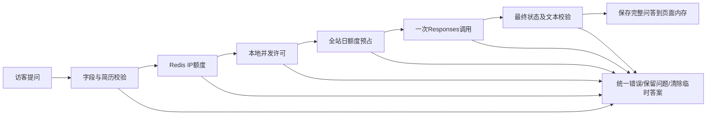
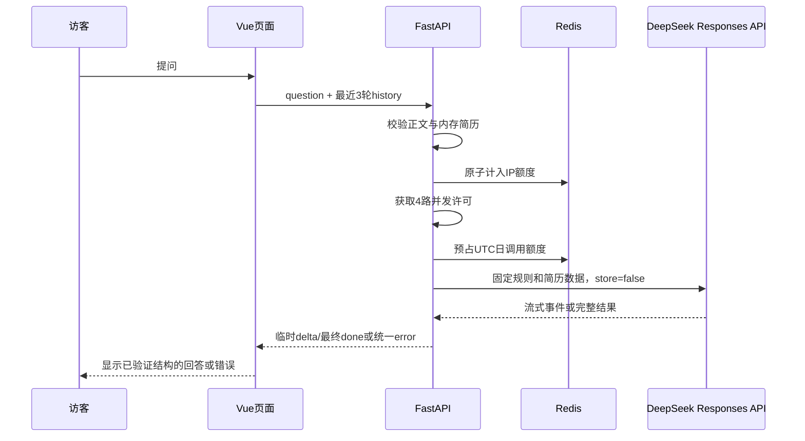

# 本轮局部需求：肖像联系页

范围：2026-11-01 用户明确要求将提供的肖像视频和 Mainframe 参考提示词融入现有「联系我」页。保留 Vue 网站、个人身份、真实联系方式及首页/关于我内容，不扩建后端。本轮实现由该请求授权；最终视觉待用户查看。

## REQ-CONTACT 肖像与联系入口

- [AC-CONTACT-1] 联系页呈现用户提供的肖像视频、个人联系文案及灰雾手写背景英文「Our story is just beginning.」，移除正文身份眉题。桌面全屏视觉，手机可完整访问主要操作，无横向溢出。
- [AC-CONTACT-2] 视频静音、内联、不自动播放。浏览器宽度45%～50%为固定正脸区，显示同一正面帧；不再延伸到人物眼睛。左于45%连续左转、右于50%连续右转，越往外转得越多；两端钳制，反向移动即逐渐回正。resize按视口百分比重算，触屏横拖沿用同一区域，停止后保持；加载或失败时保留肖像海报和全部联系入口。
- [AC-CONTACT-3] 文案延迟 600ms 后逐字显示（约 38ms/字）；操作区独立延迟 400ms 显示。减少动态效果偏好下立即呈现全文且不自动响应鼠标转头。
- [AC-CONTACT-4] “聊聊项目”和“关于我”均跳转关于我页面；复制邮箱、复制微信和访问 GitHub 使用现有真实信息并可操作。复制成功/失败有实际反馈，失败显示可手动复制的文本。
- [AC-CONTACT-5] 首页、关于我、联系我互斥且导航可用。联系页支持直接链接和刷新；手机导航可开关、键盘 Escape 退出并恢复焦点。来回切换不遗留页面事件和定时器。

- [AC-CONTACT-TEXT-1] 联系页原位置显示 Vue 实现的 “Let's talk.” 动态标题，保留大小写、完整空格、荧光绿句点和原页面层级；桌面与手机无截字、重叠或横向溢出。
- [AC-CONTACT-TEXT-2] 指针靠近时逐字改变字宽、字重和倾斜程度，离开后平滑恢复空闲波浪。使用本地可变字体的有效 wdth/wght/slnt 轴，radius=0.5、smoothing=0.5、alpha=false。
- [AC-CONTACT-TEXT-3] 默认启用 idle="wave"、idleSpeed=1 和 clickRipple=true；无人操作时波浪持续可见，点击或轻触标题后产生向外传播并衰减的压力波纹，触屏纵向滚动仍正常。
- [AC-CONTACT-TEXT-4] 标题保留完整可访问名称与 h1 语义，逐字节点不重复朗读；减少动态效果偏好下显示稳定可读的静态标题，字体加载失败仍显示完整文字。
- [AC-CONTACT-TEXT-5] 标题动画不改变原联系页版式、肖像素材或严格45%～50%正脸区；原介绍、联系入口、复制反馈和页面导航保持可用。
- [AC-CONTACT-TEXT-6] 页面往返后动画正常恢复；卸载时释放自身监听器、观察器和动画帧，离屏或页面隐藏时暂停持续动画，无新增运行错误。

## 界面约定

参考为方向而非站点身份或技术栈：不采用 Mainframe、虚构招聘/商店、参考邮箱或 React 迁移。正文信息阅读顺序为大标题、逐字介绍、联系按钮、邮箱；背景装饰英文为「Our story is just beginning.」，不再显示「石耳 / RIA · 极客 · 产品 · 项目思维」身份眉题，顶栏 RIA 标记保留。当前介绍原文为「我是石耳，一个热爱技术与分享的硬地骇客（Indie Hacker)，来和我聊聊吧～」。视频来自用户的「人头像.mp4」。实际联系方式沿用源码：rudrakshaishere@gmail.com、Ria_is_here、https://github.com/RiaHello。

样式见 [ui-style.md](ui-style.md)，实现边界见 [tech-spec.md](tech-spec.md)。本次直接制作可运行页面作为视觉交付，不另建一份静态原型。

本次标题动效依据用户提供的React Bits TextPressure完整示例，在原Vue页面局部移植；用户明确要求直接接入，沿用既有静态页面，无Mock或服务配置阶段。

介绍中的Indie Hacker作为不可拆分的英文短语显示，空间不足时整体换行；可访问原文保留普通空格。

联系页及移动菜单不显示「好的想法，从一次对话开始。」或肖像转头操作提示；不显示转头进度/朝向滑块，肖像保留鼠标与触摸控制。

## REQ-RESUME-AI 公开简历问答（用户确定需求）

按用户提供的完整需求实现Python/FastAPI后端及关于我页底部聊天，详见docs/references/resume-assistant-requirements.txt。用户明确要求直接开发，不重新选择已确定参数。真实简历不得从页面内容自动填充或用示例冒充。

- AC-RA-1：后端严格校验JSON、文本、历史、请求体及固定简历文件；错误结构不泄露输入。
- AC-RA-2：Redis原子IP/全站限额、本地4并发、30/35秒时限与单次Responses调用；故障闭锁。
- AC-RA-3：关于我底部可问答，纯文本、内存最近3轮/6000字符、失败保留问题、取消/清空、不自动重试；完整页面记录在约三轮高度的区域内滚动查看，不无限撑长页面。
- AC-RA-4：配置校验、健康检查、安全日志、锁定依赖、自动化测试与手动真实模型评测文档完整。
- AC-RA-5：默认JSON成功结构保持；网页Accept:text/event-stream使用临时delta、done、error，完成前内容不作为确定答案，失败清除草稿。此为流式/完整JSON冲突的推荐默认，已提出可选澄清。

### 流程图与时序图

2026-11-01用户确认使用DeepSeek API Key，覆盖原附件的OpenAI服务商选择；Responses接口、前端与其余验收不变。

用户明确补充：本站昵称“石耳”指陈科瑾，相关人物问题应读取同一份公开简历；新增CoT/PRM/RLHF/Self-Correction经历源于本人补充，不能据此扩写未提供的事实。
